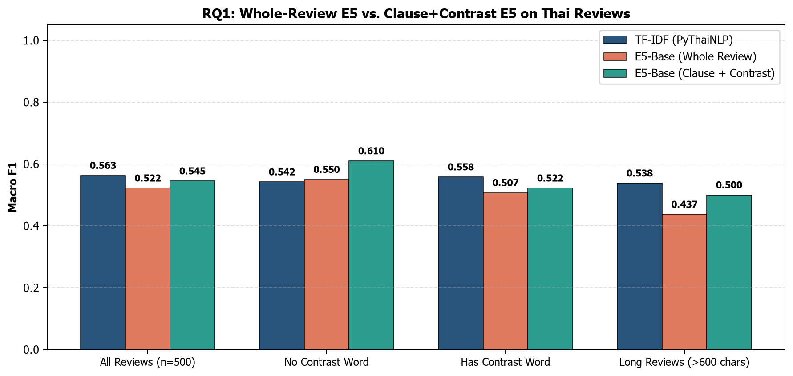
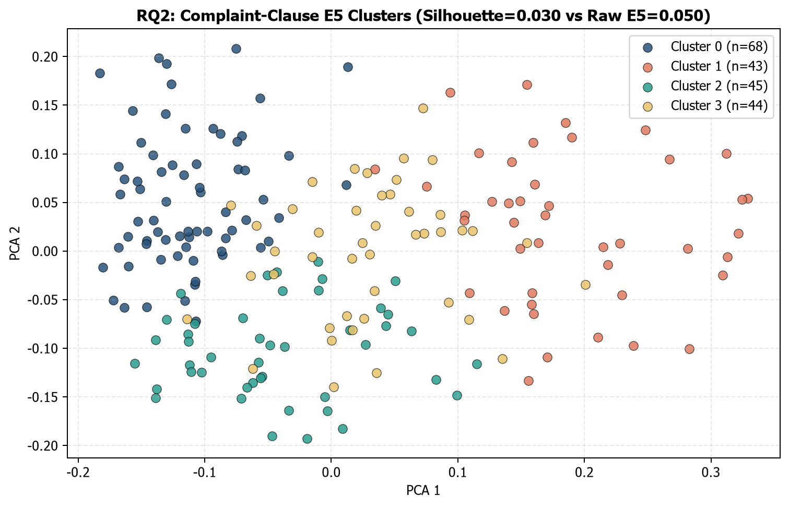
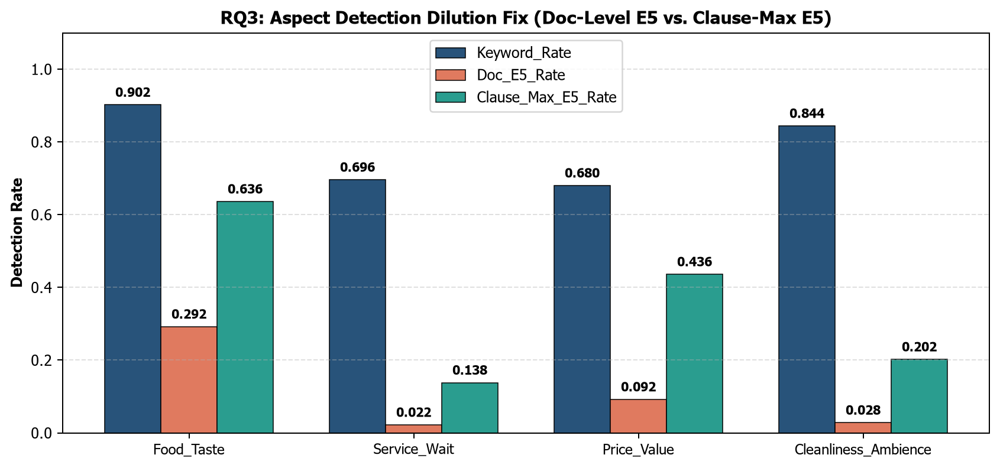

# สรุปผลการทดลองโปรเจกต์ Wongnai Thai Reviews (ฉบับส่งให้ทีม/เพื่อนดู)

- **Dataset:** [Wongnai/wongnai_reviews](https://huggingface.co/datasets/Wongnai/wongnai_reviews) (สุ่มแบบสมดุล `500` รีวิว: `Negative 200`, `Mixed_Neutral 150`, `Positive 150`; มีรีวิวที่มีคำขัดแย้ง `"แต่/เสียดาย/ติดตรง"` `382` รีวิว)
- **Notebook:** [`WONGNAI_NLP_PROJECT.ipynb`](./WONGNAI_NLP_PROJECT.ipynb)

---

## แนวคิดหลักของโปรเจกต์ (ทำไมต้องทำ 3 ขั้นตอนนี้)
1. **RQ1 (ทายดาว/อารมณ์รวม):** เช็กว่ารีวิวไทยยาวๆ ที่ชอบ *"ชมปนบ่น"* ทำให้ AI (`E5-Base`) เบลอไหม และถ้า **หั่นเป็นประโยคย่อย + เน้นช่วงขัดแย้ง (`Clause + Contrast E5`)** จะดีขึ้นแค่ไหน
2. **RQ2 (จัดกลุ่มคำบ่นอัตโนมัติ):** ลองให้ AI แยกคำบ่น 200 รีวิวออกเป็น 4 กองเองโดยไม่บอกหัวข้อ $\rightarrow$ **ผลคือแยกไม่ขาด** เพราะลูกค้า 1 คนบ่นหลายเรื่องปนกันในรีวิวเดียว
3. **RQ3 (แยกจับทีละหัวข้อ 4 ด้าน):** เลยเปลี่ยนมาตั้งหัวข้อ 4 ด้าน (`อาหาร`, `บริการ`, `ราคา`, `ความสะอาด`) แล้วให้ AI เช็ก **ทีละประโยค (`Clause-Max E5`)** แทนเทียบทั้งรีวิว $\rightarrow$ **แก้ปัญหาความหมายโดนกลบได้สำเร็จ (พุ่งขึ้น 2–7 เท่า)**

---

## 1. RQ1: ทายความรู้สึก (`TF-IDF` vs. `Whole E5` vs. `Clause+Contrast E5`)

| กลุ่มข้อมูล | `TF-IDF (PyThaiNLP)` | `E5-Base (Whole Review)` | `E5-Base (Clause + Contrast)` |
| :--- | :---: | :---: | :---: |
| **All Reviews (`n=500`)** | **0.563** | 0.522 | 0.545 |
| **No Contrast Word** | 0.542 | 0.550 | **0.610** |
| **Has Contrast Word** | **0.558** | 0.507 | 0.522 |
| **Long Reviews (`>600` chars)** | **0.538** | 0.437 | 0.500 |

- **สิ่งที่เจอ:**
  - `Clause + Contrast E5` ชนะ `Whole-Review E5` **ทุกกลุ่ม** โดยเฉพาะรีวิวยาว (`0.437` $\rightarrow$ **`0.500`**, +6.3 จุด) และรีวิวพูดทางเดียว (`0.610`)
  - แต่ในรีวิวที่มีคำขัดแย้งเยอะ (`Has Contrast`) คำตรงตัวแบบ `TF-IDF` (`0.558`) ยังชนะ E5 เพราะจับคำชี้ขาดอย่าง `แพง`, `คาว`, `ไม่ประทับใจ` ได้ตรง

---

## 2. RQ2: จัดกลุ่มคำบ่น 200 รีวิวแง่ลบ (`1–2★`) ด้วย K-Means (`k = 4`)

- **`Raw E5` (ทั้งรีวิว):** `Silhouette = 0.050`
- **`Complaint-Clause E5` (เฉพาะประโยคที่บ่น):** `Silhouette = 0.030` (`4` กลุ่ม: `68, 43, 45, 44` รีวิว)

- **สิ่งที่เจอ:**
  - ค่า `Silhouette` ต่ำมากและจุดยังซ้อนกัน เพราะ 1 รีวิวบ่นหลายเรื่องพร้อมกัน (เช่น *อาหารคาว + ราคาแพง + รอนาน*) การจัดกลุ่มแบบ Unsupervised เลยแยกเป็นกองเดี่ยวๆ ไม่ขาด $\rightarrow$ **เป็นเหตุผลที่ต้องเปลี่ยนไปทำ Multi-Aspect ใน RQ3**

---

## 3. RQ3: จับหัวข้อ 4 ด้าน (`Doc-Level E5` vs. `Clause-Max E5` vs. `Keyword`)

| หัวข้อ (Aspect) | `Keyword_Rate` | `Doc_E5_Rate` (ทั้งรีวิว) | `Clause_Max_E5_Rate` (ทีละประโยค) | เพิ่มขึ้นจาก `Doc_E5` |
| :--- | :---: | :---: | :---: | :---: |
| **`Food_Taste` (อาหาร/รสชาติ)** | 0.902 | 0.292 | **0.636** | **2.2x** |
| **`Service_Wait` (บริการ/รอคิว)** | 0.696 | 0.022 | **0.138** | **6.3x** |
| **`Price_Value` (ราคา/คุ้มค่า)** | 0.680 | 0.092 | **0.436** | **4.7x** |
| **`Cleanliness_Ambience` (ความสะอาด/ร้าน)** | 0.844 | 0.028 | **0.202** | **7.2x** |

- **สิ่งที่เจอ:**
  - ถ้าเทียบทั้งรีวิวยาว (`Doc_E5`) เรื่องรองๆ อย่าง **บริการ (`2.2%`)** และ **ความสะอาด (`2.8%`)** จะโดนเรื่องอาหารกลบหมด
  - พอเปลี่ยนมาเทียบทีละประโยคแล้วเอาค่าสูงสุด (`Clause_Max_E5`) อัตราการจับเจอพุ่งขึ้น **2–7 เท่า** ทันที
